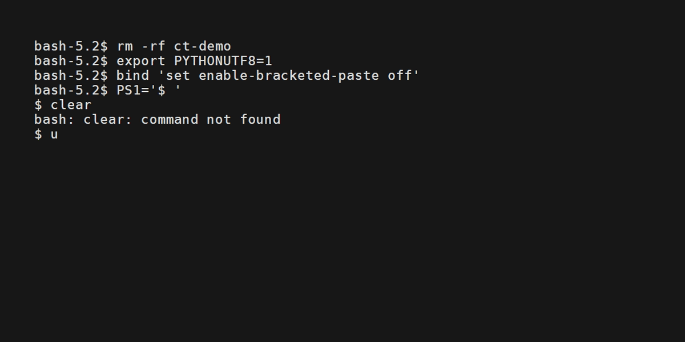

# cn-textbook-downloader

从 GitHub 下载 [ChinaTextbook](https://github.com/qdriven/ChinaTextbook) 教材仓库的命令行工具（uv + typer + textual TUI）。

- **download** — 启动下载任务（TUI 进度界面，自动断点续传）
- **resume** — 继续未完成的下载任务
- **test** — 校验已下载的文件（存在性 / 大小 / Git blob SHA）

下载来源为 GitHub，命令为 `download` / `resume` / `test`；来源逻辑通过 `Source` 抽象接入，详见 [docs/architecture.md](docs/architecture.md)。

## 演示



## 快速开始

```bash
uv sync

uv run cn-textbook download          # TUI 下载
uv run cn-textbook resume           # 断点续传
uv run cn-textbook test             # 校验
```

完整文档见 [docs/](docs/index.md)。
