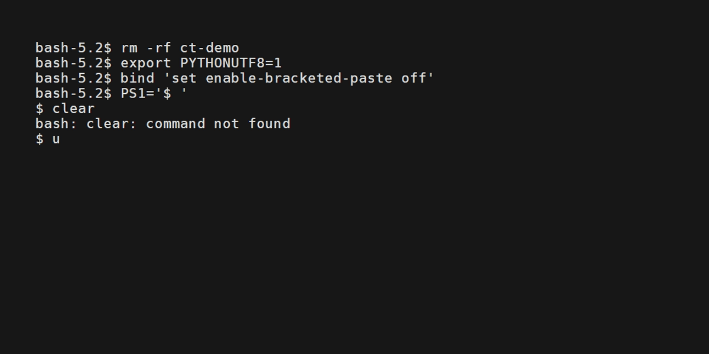

# cn-textbook 文档

`cn-textbook` 是一个命令行工具，用于从 GitHub 下载 [ChinaTextbook](https://github.com/qdriven/ChinaTextbook) 教材仓库，支持断点续传与完整性校验。



## 特性

- **断点续传**：下载中断后重新运行同一命令即可继续；`.part` 临时文件保存断点，已完成文件自动跳过
- **完整性校验**：每个文件按 Git blob SHA-1 校验，与仓库内容严格一致
- **TUI 界面**：下载进度交互式展示（textual），也可用 `--no-tui` 输出普通日志
- **GitHub 来源**：下载来源为 GitHub；来源逻辑通过 `Source` 抽象组织，便于以后扩展

## 安装

需要 [uv](https://docs.astral.sh/uv/) 与 Python 3.10+。

```bash
uv sync
```

安装后提供 `cn-textbook` 命令（也可 `uv run cn-textbook ...`）。

## 快速开始

```bash
# 下载（TUI）
uv run cn-textbook download

# 中断后继续
uv run cn-textbook resume

# 校验已下载的文件
uv run cn-textbook test
```

## 文档目录

- [项目文案](marketing.md) — 对外介绍：解决什么问题、好处是什么
- [使用指南](usage.md) — 全部命令与选项
- [架构设计](architecture.md) — 模块结构、来源插件机制、断点续传原理
- [开发指南](development.md) — 环境搭建、测试、如何添加新来源
